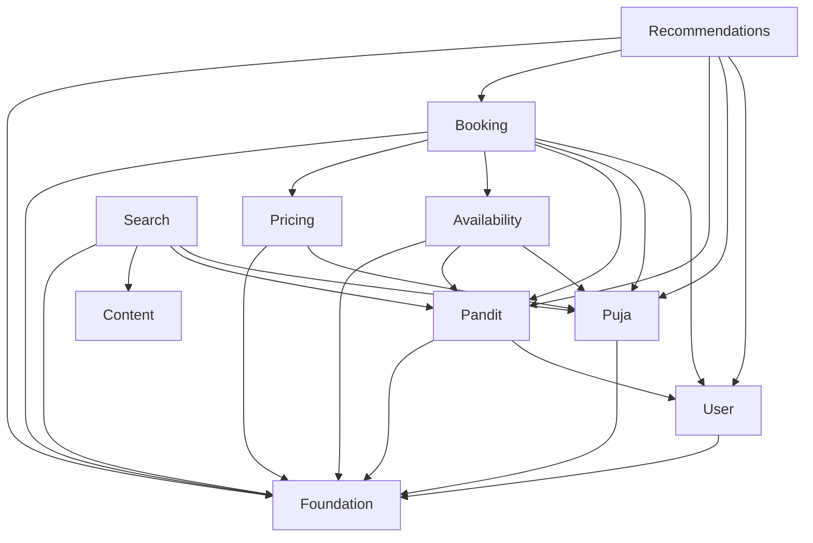
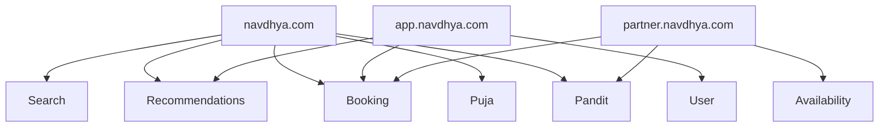
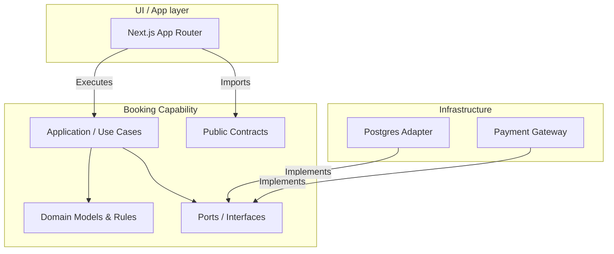

# Architecture Dependency Graph

## Business Capabilities

The capabilities follow a strict dependency direction. Cycles (e.g., A -> B -> A) are forbidden.

## Application vs Capability

## Capability Internal Architecture (Ports & Adapters)

Each capability strictly implements a Ports & Adapters (Hexagonal) architecture.

