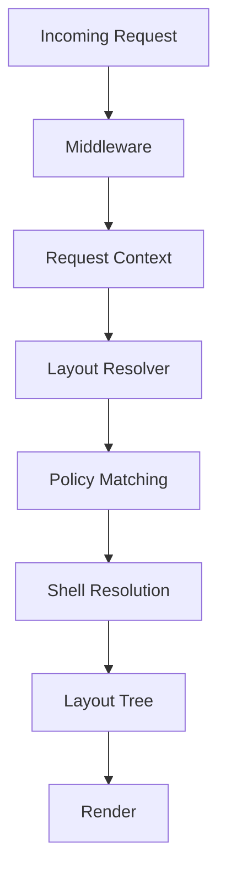

# DLO-X Architecture

Deterministic Layout Orchestrator — eXact (DLO-X) is a production-ready, scalable architecture for Next.js 15 App Router applications that provides deterministic layout resolution based on policies.

## Features

- **Policy-Based Layout Resolution**: Define layout policies using a fluent DSL
- **Deterministic Rendering**: Consistent layout resolution based on path, role, tenant, and device
- **A/B Testing**: Built-in support for deterministic A/B testing with seeded hashing
- **Caching**: In-memory and Redis-compatible caching for performance
- **Telemetry**: Built-in telemetry for layout resolution events
- **Security**: Zero PII in telemetry, strict server-only data flows
- **CLI Tools**: Command-line interface for generating components and validating policies
- **Type Safety**: Full TypeScript support with Zod validation

## Architecture Overview



## Getting Started

### Installation

```bash
npm install zod
```

### Initialize DLO-X

```bash
npx dlo init
```

### Generate Components

```bash
# Generate a shell component
npx dlo generate shell MyShell

# Generate a page
npx dlo generate page my-page

# Generate a policy
npx dlo generate policy my-policy
```

### Inspect Policies

```bash
npx dlo inspect --path=/dashboard --role=User --tenant=default
```

### Validate Policies

```bash
npx dlo validate
```

### Check Coverage

```bash
npx dlo coverage --sitemap=./sitemap.txt
```

## Core Concepts

### Layout Policies

Layout policies define which shells should be used for specific paths, roles, tenants, and devices:

```typescript
const dashboardPolicy = PolicyBuilder.create()
  .id('user-dashboard')
  .path('/dashboard/*')
  .role('User')
  .use('MainShell', 'DashboardShell')
  .priority(20)
  .build();
```

### Shells

Shells are React components that wrap your content with specific layouts:

```tsx
export function DashboardShell({ children }: { children: ReactNode }) {
  return (
    <div className="min-h-screen bg-background">
      <DashboardHeader />
      <main className="flex-grow">
        {children}
      </main>
      <DashboardFooter />
    </div>
  );
}
```

### Layout Orchestrator

The LayoutOrchestrator resolves the appropriate layout tree based on the request context:

```tsx
export default function HomePage() {
  const context = {
    requestId: 'home-page-request',
    tenantId: 'default',
    userRole: 'User',
    device: 'desktop',
    seed: 'home-page-seed',
    path: '/'
  };

  return (
    <LayoutOrchestrator context={context}>
      <div>Home Page Content</div>
    </LayoutOrchestrator>
  );
}
```

## Security

- No PII in telemetry
- Strict server-only data flows
- Sanitized user input
- Least privilege enforcement
- Safe fallback shells

## Performance

- In-memory caching with TTL
- Redis-compatible caching interface
- Zero re-renders unless needed
- Edge vs Node deterministic behavior
- No async predicates in Edge runtime

## CLI Commands

| Command | Description |
|---------|-------------|
| `dlo init` | Initialize DLO-X in the current project |
| `dlo generate shell <name>` | Generate a shell component |
| `dlo generate page <name>` | Generate a page component |
| `dlo generate policy <name>` | Generate a policy |
| `dlo inspect --path=<path> --role=<role> --tenant=<tenant>` | Inspect layout policy |
| `dlo validate` | Validate all layout policies |
| `dlo coverage --sitemap=<file>` | Generate coverage report |

## Documentation

- [File Templates](./dlo-x-file-templates.md)
- [Folder Structure](./dlo-x-folder-structure.md)
- [Naming Conventions](./dlo-x-naming-conventions.md)
- [TypeScript Types](./dlo-x-types.md)
- [Predicate Registry](./dlo-x-predicate-registry.md)
- [Testing Structure](./dlo-x-testing-structure.md)

## License

MIT